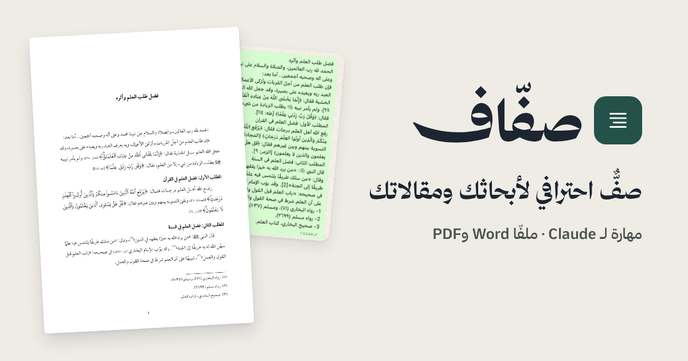

# صفّاف

مهارةٌ لـ Claude تصفّ الأبحاث والمقالات والرسائل العلمية العربية بخطّ لوتس لطفي، وتُخرجها في ملفَّي Word وPDF.
ترسل نصّك وتكتب «صفّه»، فيصلك بحثك مصفوفًا دون أن يُمَسّ منه حرف.

**[نزّل صفّاف](https://github.com/iiAMMAR11/saffaf/releases/latest/download/saffaf.zip)**

## المزايا

- **لا يغيّر حرفًا من نصّك:** عمله الصفّ وحده، وما يراه من ملاحظات لغوية يذكره لك في ردّه ولا يُدخله في الملف.
- **لوحة إعدادات:** يقرأ صفّاف نصّك أولًا، ثم يعرض عليك إعدادات صفّه ومعها ما يقترحه، فتختار ما تريد أو تكتب «موافق».
- **الفهارس (اختيارية):** الآيات القرآنية، والأحاديث النبوية، والآثار، والأعلام، ورواة الحديث، والأنساب، والكلمات الغريبة، والشواهد الشعرية، والأماكن والبلدان، والمصطلحات، والمصادر والمراجع، والموضوعات؛ بأرقام صفحات تلقائية.
- **الرسائل العلمية بدليل جامعة الملك خالد (اختياري):** رسالة الماجستير أو الدكتوراه بخط Traditional Arabic ومقاساته في الدليل: صفحة العنوان بشعار الجامعة الذي ترفعه، وصفحة إجازة الرسالة بجدول لجنة المناقشة، والأوائل مرقّمة بالحروف، وصفحة مستقلة لكل باب ولكل ملحق، وقائمة المحتويات وقائمتا الجداول والأشكال؛ وينبّهك على ما يطلبه الدليل وينقص من رسالتك.
- **نظام الإحالة (اختياري):** Chicago أو APA أو Harvard أو MLA أو IEEE في الحواشي وقائمة المصادر. وما ينقص من بيانات المصادر يسألك عنه، ولا يضعه من عنده.
- **الترويسة والخط والبسملة (اختيارية):** عنوان البحث أعلى الصفحات، وخط Traditional Arabic بدل لوتس لطفي، والبسملة التي يفتتح بها البحث بإحدى بسملات لوتس لطفي المخطوطة.
- **الرسم العثماني للآيات (اختياري):** إذا طلبتَه تعرّف صفّاف على الآية من حروفها، بتشكيل أو بدونه، ثم كتبها بنصّ المصحف وضبطه برواية حفص. ولا ينظر إلا فيما دللتَ على أنه آية: ما بين القوسين ﴿ ﴾، وما بين علامتي تنصيص بعد «قال تعالى» ونحوها. وما لم يطابق حروف المصحف بقي كما كتبتَه ونُبِّهتَ عليه في الرد.
- **صفٌّ على طريقة الكتب المطبوعة:** مسافة بادئة في أول كل فقرة، وحواشٍ في أسفل الصفحة رقمُها على السطر ونصُّها معلَّق، وسطور مضبوطة، وعنوان المقالة واسم كاتبها في صدرها.
- **الحواشي الإنجليزية:** الحاشية المكتوبة بالحروف اللاتينية تُصفّ من اليسار بخط Times New Roman.
- **الأرقام المشرقية:** أرقام الصفحات والحواشي والفهرس بالأرقام المشرقية (١٢٣).
- **غلاف وفهرس:** غلافٌ وفهرسٌ للموضوعات بأرقام صفحات تلقائية.
- **جداول** لا تنقسم كلماتها، وتنسيقٌ لإحالات الآيات وسنوات الوفيات.

## الصيغ المقبولة

يقبل صفّاف النص الملصوق في المحادثة مباشرةً، والملفات بهذه الصيغ:

`DOCX` · `DOC` · `ODT` · `RTF` · `HTML` · `EPUB` · `TXT` · `MD`

ولا يقبل ملفات PDF ولا الصور؛ لأن النص المستخرج منها تتلف حروفه، وصفّاف لا يخمّن حروف المؤلف. أرسل الأصل: ملف Word أو النص نفسه.

ويُخرج لك ملفين: Word ‏(`.docx`) وPDF، ومعهما ملف مضغوط واحد «خطوط-لملف-Word.zip» فيه الخطوط التي يحتاجها ملف Word.

## التثبيت

1. **نزّل الملف وارفعه:** نزّل [saffaf.zip](https://github.com/iiAMMAR11/saffaf/releases/latest/download/saffaf.zip)، ثم ارفعه في Claude من: ‏Settings › Skills › + › Upload a skill
2. **فعّله من القائمة:** ستجده في قائمة المهارات باسم `saffaf`.
3. **أرسل بحثك واكتب: «صفّه»**، فيعرض عليك إعدادات صفّه، ثم يصلك مصفوفًا في Word وPDF.

> **تنبيه:** يجب أن يكون خيار Code execution مفعّلًا في ‏Settings › Capabilities، وإلا لم تعمل المهارة.

## ملف Word

- لعرضه بالخط الصحيح فكّ الملف المضغوط «خطوط-لملف-Word.zip» وثبّت الخطوط التي فيه؛ وملف PDF لا يحتاج شيئًا.
- أرقام الحواشي فيه تتبع إعداد «Numeral» في Word عند القارئ، ولإظهارها مشرقية يُختار Context أو Hindi؛ وهي في ملف PDF مشرقية دائمًا.

## الملاحظات والأخطاء

ملاحظاتك تحسّن صفّاف. أرسلها من صفحة [Issues](https://github.com/iiAMMAR11/saffaf/issues/new/choose) واختر أحد القالبين:

- **ملاحظة أو اقتراح:** لما تتمنى إضافته أو تغييره.
- **بلاغ عن خطأ:** لما خرج على غير ما ينبغي.

تحتاج حسابًا مجانيًّا في GitHub. وما تكتبه هناك يراه الجميع، فلا ترفق نصًّا لا تريد نشره.

## الرخصة

رخصة MIT، ونصّها في ملف [LICENSE](LICENSE)، للكود فقط. والمستودع يحوي أيضًا موادَّ ليست تحت هذه الرخصة:

- **خط لوتس لطفي:** لصاحبه لطفي الطوخي، منشور مجانًا بإذنه.
- **خط الآيات:** خط الرسم العثماني – حفص (KFGQPC HAFS Uthmanic Script 2.2)، من إصدار مجمع الملك فهد لطباعة المصحف الشريف بالمدينة المنورة، يُستخدم ويوزَّع مجانًا وفق رخصته المضمَّنة فيه دون تعديل، ولا يُباع.
- **نصّا المصحف (العثماني والإملائي):** من مكتبة QUL ‏(qul.tarteel.ai)، والنص العثماني من إصدار المجمع. وهما في المهارة مجموعان في ملف واحد دون تغيير في النص.
- **خط Traditional Arabic:** لشركة Microsoft، ويُستعمل بطلب المستخدم وحده.
- **خط PT Bold Heading:** صمّمته Platinum لشركة Microsoft، ويُستعمل لعنوان الرسالة العلمية وحده في نمط دليل جامعة الملك خالد.
- **خط الرموز:** Noto Naskh Arabic من مشروع Noto، برخصة SIL Open Font License 1.1، لرموز التعظيم التي ليست في لوتس لطفي (ﷻ ﷽ ﵁ وأخواتها)، دون تعديل.

---

[iiammar.com](https://iiammar.com)

